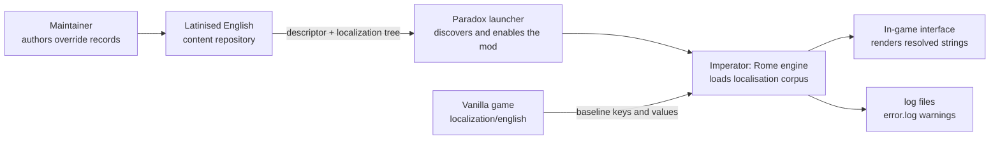
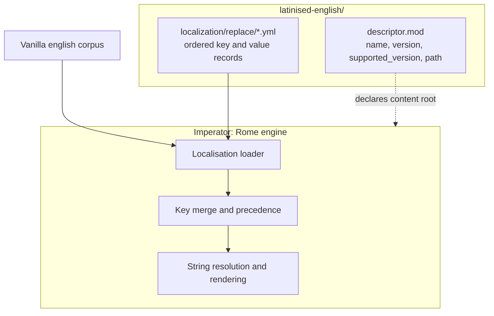
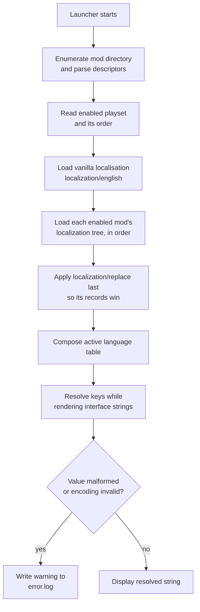
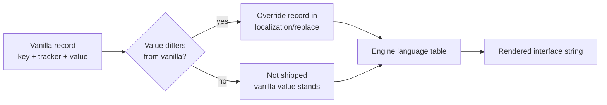
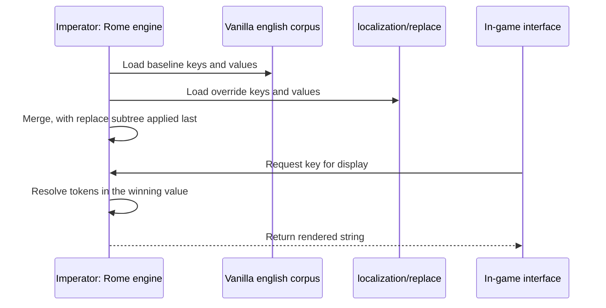
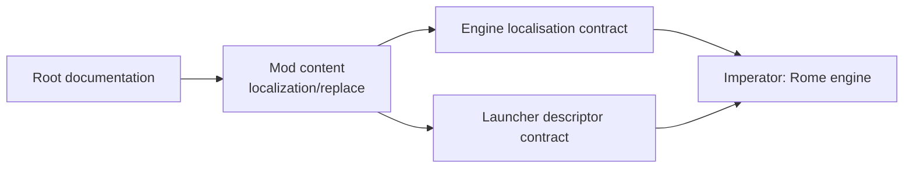

# Latinised English Architecture

This document describes the verified current architecture of the Latinised English mod for Imperator: Rome, a content-only package whose behaviour is entirely determined by the game engine's localisation loading and key resolution contract. It documents the shipped mod content, the vanilla localisation corpus it overrides, and the constraints that govern any change to that content.

## 📑 Table of Contents

- [Purpose](#-purpose)
- [System Context](#-system-context)
- [Architectural Style](#-architectural-style)
- [Runtime Process](#-runtime-process)
- [Architectural Areas](#️-architectural-areas)
  - [Mod Content](#mod-content)
  - [Repository Metadata](#repository-metadata)
- [Data Architecture](#-data-architecture)
- [Interfaces and Integrations](#-interfaces-and-integrations)
- [Key Processes](#-key-processes)
  - [Localisation Override Resolution](#localisation-override-resolution)
- [Cross-Cutting Concerns](#-cross-cutting-concerns)
  - [Security and Privacy](#security-and-privacy)
  - [Error Handling](#error-handling)
  - [Observability](#observability)
  - [Configuration](#configuration)
- [Dependency Direction and Rules](#-dependency-direction-and-rules)
- [External Dependencies](#-external-dependencies)
- [Deployment and Operations](#-deployment-and-operations)
- [Compatibility Contracts](#️-compatibility-contracts)
- [Testing and Verification](#-testing-and-verification)
- [Design Constraints](#️-design-constraints)
- [Extension Points](#-extension-points)
  - [Adding a Localisation Override File](#adding-a-localisation-override-file)

## 🎯 Purpose

The repository supplies a set of English localisation override files that replace selected vanilla Imperator: Rome strings with latinisations: British spellings, words with Latin ancestry, and context-sensitive substitutions drawn from the `english-language` vocabulary rules. The system boundary is the mod content directory and its launcher descriptor; nothing outside that boundary executes.

The audience is the mod maintainer, contributors authoring overrides, and users diagnosing why a displayed string did or did not change. Recording these boundaries matters because the mod has no runtime of its own: every observable behaviour is produced by the host engine reading these files, so the architecture is the file layout plus the engine contract, and nothing more.

## 🌐 System Context

The system is a packaged content directory consumed by Imperator: Rome. The engine discovers the mod through a launcher descriptor, loads every localisation file present, and merges it into the active language table. The shipped overrides are static data; the only actor that initiates behaviour is the game engine.



The principal external boundaries are:
- **Paradox launcher:** reads `latinised-english.mod` and `latinised-english/descriptor.mod` to list and enable the mod, and resolves the declared `path` to the content directory. The launcher owns enablement, load order, and the playset.
- **Vanilla game localisation:** the installed `localization/english` tree is the authoritative baseline. It owns every key and every value that is not overridden, and it names the files this mod mirrors.
- **Imperator: Rome engine:** owns parsing, encoding validation, merge precedence, and key resolution. It reads the files and produces all user-visible output.
- **Log files:** the engine writes load-time warnings for malformed values, invalid encoding, and duplicate keys. The log is the only diagnostics surface, and the repository does not read it.

## 🏗️ Architectural Style

The verified style is a **content-only host extension**: a declarative data package with no executable component, composed entirely of host-format files whose semantics the host defines. There is no compilation step, no package manager, no build pipeline, and no runtime process owned by the repository.

Two structural conventions implement that style:

1. **Path mirroring.** Each override sits at the same relative path as its vanilla source under a single `replace` directory, so the correspondence between a vanilla file and its override is mechanical rather than recorded anywhere.
2. **Minimal override sets.** Only records whose value differs from vanilla are shipped, so the mod carries no redundant data and the diff against vanilla is the complete change set.



The principal architecture boundaries are:
- **Descriptor boundary:** the launcher descriptor is the only file the host reads before loading content. It declares identity, version, supported game version, and the content path, and it is the sole integration point with the launcher.
- **Localisation boundary:** the `localization/replace` tree is the entire content surface. Every shipped record is a key and value pair in this boundary, and no other file type is present.
- **Documentation boundary:** the root Markdown documents and the package metadata describe the system but are never read by the host.

## 🔄 Runtime Process



The principal runtime sequence is:
1. The launcher enumerates the mod directory, parses `latinised-english.mod`, and resolves the declared content path.
2. The engine loads the vanilla English corpus, then loads each enabled mod's localisation tree in playset order.
3. The engine applies the `localization/replace` subtree after every other localisation source, so a record placed there wins over a duplicate key regardless of file ordering.
4. The engine resolves each key against the composed table when the interface requests it, rendering hover commands, variables, text icons, and colour codes in place.
5. The engine writes a warning to `error.log` for a malformed value or an unsupported encoding, and otherwise renders the resolved string unchanged.

## 🗂️ Architectural Areas

### Mod Content

Paths:
- `latinised-english/descriptor.mod`
- `latinised-english/localization/replace/`

Responsibilities:
- Declare the mod identity, version, supported game version, tags, and content path for the launcher.
- Carry every localisation override record, expressed as an `l_english` key and value pair.
- Preserve the vanilla relative file name for each override, with the `_latinised` marker inserted before the language suffix.

Boundary rules:
- `descriptor.mod` must remain at the content root; the launcher uses it to update a published mod and deleting it orphans that entry.
- Every override must live under `localization/replace/`, because that subtree is what guarantees precedence over vanilla and over other mods' default-tree localisation.
- The content directory must contain no file the engine cannot parse, because the loader processes every file it finds.

### Repository Metadata

Paths:
- `latinised-english.mod`
- `LICENSE`
- `.gitignore`
- `.github/cover.png`
- `README.md`, `ARCHITECTURE.md`, `CONTRIBUTING.md`, `CODE_OF_CONDUCT.md`, `SECURITY.md`, `PRIVACY.md`

Responsibilities:
- Provide the local-mod descriptor the launcher lists before publication.
- Record the licence, exclude transient working directories, and supply repository landing-page artwork.
- Document the system for maintainers, contributors, and users.

Boundary rules:
- Repository metadata must never depend on mod content semantics; it describes the package rather than participating in loading.
- Documentation claims must be grounded in the shipped content and the engine contract, never in intended but unimplemented capability.

## 💾 Data Architecture

The system owns no store, cache, or persistent state. Its only data is the set of override records, which is static, read-only at runtime, and derived from the vanilla corpus.



| Data or Store | Owner | Representation and Storage | Lifecycle or Consistency |
|---------------|-------|----------------------------|--------------------------|
| Override record | Mod content | `key:tracker "value"` line in a UTF-8-BOM `.yml` file under `localization/replace/` | Authored once, shipped statically, superseded by changing the file |
| Mod descriptor | Launcher | `key="value"` block in `descriptor.mod` and `latinised-english.mod` | Read at launcher start; rewritten by the launcher on publication |
| Vanilla baseline | Game installation | `localization/english` tree in the game directory | Owned by the game; changes only with a game update |
| Composed language table | Engine | In-memory map from key to resolved value | Rebuilt on every load; lost on exit |

## 🔌 Interfaces and Integrations

| Interface or Integration | Direction | Contract | Owner | Failure Semantics |
|--------------------------|-----------|----------|-------|-------------------|
| Launcher descriptor | Inbound | `name`, `version`, `supported_version`, `tags`, `path` keys in a `.mod` file | Launcher | An unreadable or mislocated descriptor makes the mod invisible; the mod is skipped without an in-game error |
| Localisation file | Inbound | `<file>_l_<language>.yml` name, `l_<language>:` header, UTF-8-BOM encoding, `key:tracker "value"` records | Engine | A non-conforming file name is ignored entirely; a missing BOM produces a warning; a malformed record is discarded |
| Engine tokens in values | Outbound | Hover commands in square brackets, variables in dollar signs, text icons, colour codes, and `\n` escapes | Engine | A malformed token renders literally or resolves to a placeholder instead of the intended content |

## 🔀 Key Processes

### Localisation Override Resolution



Ordering and ownership are the whole of the mechanism. The `replace` subtree is applied after every other localisation source, which is what makes the override deterministic: a record shipped here wins over a duplicate key in the vanilla tree or in another mod's default tree, without depending on file order or playset position. The engine owns the merge, so the repository's only lever is where a record is placed and whether its value is well formed.

A record that is absent, because its value matches vanilla, is not a defect: the vanilla value remains in the table and is indistinguishable from an override that happened to be identical.

## 🧵 Cross-Cutting Concerns

### Security and Privacy

The trust boundary is the game installation: the repository ships text the engine parses within the same trust domain as vanilla content. There is no network communication, no credential handling, no personal data, and no executable payload. The relevant safety concern is content integrity rather than adversarial input, and it is addressed by keeping every value a pure substitution that preserves the engine tokens byte-for-byte.

### Error Handling

Failures originate in the engine, not in the repository, and they are silent or near-silent. A file that does not match the localisation naming pattern is ignored entirely, with no output at all. A file missing its BOM produces a load warning. A record whose value contains an invalid token renders incorrectly rather than raising an error. The repository therefore cannot catch a failure at runtime; it prevents one by validating that every shipped value is a documented substitution of its vanilla counterpart with the token sequence preserved.

### Observability

The only signal is the engine's own log, at `<user data>/Imperator/logs/error.log`, which records encoding and parsing warnings. There are no metrics, traces, or health checks, and the repository emits nothing. The practical diagnostic gap is that a suppressed substitution is invisible: an override that was never authored and an override that was authored but not loaded both present as unchanged vanilla text, so distinguishing them requires reading the shipped files rather than observing the game.

### Configuration

| Configuration Area | Source | Responsibility | Supersede or Secret Policy |
|--------------------|--------|----------------|---------------------------|
| Mod identity and target version | `latinised-english.mod`, `latinised-english/descriptor.mod` | Declares the name, version, tags, `supported_version`, and content path the launcher reads | No secrets; `supported_version` must track the game version the mod targets |
| Enablement and load order | Launcher playset | Determines whether the mod loads and its position relative to other mods | Owned by the user; the `replace` subtree makes precedence independent of order |
| Active language | Game settings | Selects which language table is composed | Only `l_english` records are shipped, so the overrides apply to English play only |

## 🧭 Dependency Direction and Rules

Dependencies point inward from documentation to content to the host contract, and never outward from content to anything the repository controls.



The principal dependency rules are:
- Mod content may depend on the engine contract and the vanilla key set; it must not depend on repository metadata, documentation, or tooling.
- Each override must mirror the vanilla source path so the correspondence stays derivable from names alone.
- The descriptor must remain self-contained; it must not reference any file outside the content directory.
- No file may be added to the content directory that the engine cannot parse as localisation or as a descriptor.

## 📦 External Dependencies

| Dependency | Responsibility | Integration Boundary | Architectural Consequence |
|------------|----------------|----------------------|---------------------------|
| `Imperator: Rome at version 2.0.*` | Parses the descriptor, loads the localisation corpus, composes the language table, and renders strings | The engine's localisation loader | Every invariant the repository can rely on is defined by the engine version, so a game update can change parsing and precedence |
| Vanilla English localisation corpus | Supplies the baseline key set and the file names the overrides mirror | The installed game directory | Override file names and key names are dictated by the installation, not by the repository |
| `english-language` vocabulary rules | Supplies the substitution set and the sense conditions applied when authoring records | Maintainer process, not runtime | Substitutions are applied by judgement at authoring time, so records carry no mechanical provenance |

## 🚀 Deployment and Operations

The deployment unit is the content directory together with its descriptor. There is no process to start, no service to expose, and no persistent state to migrate.

| Concern | Current Design | Architectural Consequence |
|---------|----------------|---------------------------|
| Process topology | None; the engine hosts all execution | The repository cannot observe, instrument, or repair behaviour at runtime |
| Deployment mechanism | Copying `latinised-english/` and `latinised-english.mod` into the user mod directory | A leftover file from a previous version collides with the new one, so replacement must be a full removal followed by a copy |
| Availability | Continuous; static files are either present or absent | There is no degraded mode, only a loaded mod or an ignored one |
| Recovery | Deleting the mod directory and descriptor | Recovery is total, because the mod owns no external state |
| Checksum effect | Any localisation override alters the checksum | Achievements are disabled and ironman saves can be corrupted, so ironman use must be discouraged |
| Operator-visible output | The launcher mod list and the engine log | Verification is confined to the launcher and the log, with no in-repository signal |

## 🛡️ Compatibility Contracts

| Contract | Owner | Invariant | Verification | Change Policy |
|----------|-------|-----------|--------------|---------------|
| Descriptor schema | Launcher | `name`, `version`, `supported_version`, `tags`, and `path` remain present and correctly typed | Launcher lists the mod with the declared name and version | Only `version` and `supported_version` may change without a compatibility review |
| Localisation file naming | Engine | `<file>_l_english.yml` with the `_latinised` marker inserted before the suffix | Every shipped file resolves to a vanilla counterpart at the mirrored path | A renamed file must stay loadable and must keep its mirror correspondence |
| File encoding and header | Engine | UTF-8 with BOM, first content line `l_english:` | Byte inspection of the first three bytes and the first line | Never relaxed; a missing BOM produces a load warning |
| Record shape | Engine | `key:tracker "value"` with the value fully quoted | Line-level inspection of every shipped record | Tracker values may change freely; key names must match vanilla |
| Engine token sequence | Engine and vanilla values | Every hover command, variable, text icon, colour code, and `\n` escape appears in the shipped value in the same order and form as in vanilla | Token-sequence comparison against the vanilla value | Never relaxed; an altered sequence breaks the consuming string |
| Substitution scope | Maintainer | Every shipped value is a documented substitution of its vanilla counterpart, changing no word that the vocabulary rules do not cover | Substitution inventory derived from the vanilla and shipped values | A new substitution class requires an explicit vocabulary-record justification |

## ✅ Testing and Verification

Verification is manual and comparative, because the repository has no test project and the engine exposes no assertion surface. The verifiable boundary is the pair of a shipped override and its vanilla source.

The core check is that each override file parses under the localisation rules, that every key it contains exists in the corresponding vanilla file, that no value is identical to its vanilla counterpart, and that every engine token sequence is preserved. A shell one-liner over a single pair performs the structural part of that check:

```bash
python3 - <<'PY'
import re
VAN = '/path/to/game/localization/english/alerts_l_english.yml'
GEN = 'latinised-english/localization/replace/alerts_latinised_l_english.yml'
TOK = re.compile(r"\[[^\]]*\]|\$[^$]*\$|@[A-Za-z0-9_]+!|#[A-Za-z]+ ?|#!|\\n")
def load(path):
    out = {}
    for line in open(path, encoding='utf-8-sig').read().splitlines():
        m = re.match(r'^\s*([A-Za-z0-9_.\-]+):(\d*)\s*"(.*)"\s*$', line)
        if m:
            out[m.group(1)] = m.group(3)
    return out
van, gen = load(VAN), load(GEN)
assert not [k for k in gen if k not in van], 'unknown key'
assert not [k for k in gen if van[k] == gen[k]], 'redundant record'
assert not [k for k in gen if TOK.findall(van[k]) != TOK.findall(gen[k])], 'token drift'
print('ok', len(gen), 'of', len(van))
PY
```

The manual verification steps are:
1. Enable the mod in the launcher and confirm the mod list shows the declared name and version.
2. Launch the game and confirm the affected strings display the overridden wording.
3. Read `<user data>/Imperator/logs/error.log` and confirm no encoding or parse warning names a shipped file.

Material coverage gaps and constraints:
- There is no automated test suite, so every check is manual and no regression is caught without running it.
- Coverage is partial by design, so absence of an override is indistinguishable from a suppression without reading the files.
- Engine-side behaviour can only be verified against an installed game, so the repository cannot be validated in isolation.

## ⚠️ Design Constraints

- **No runtime of its own:** The mod is data only. Any behaviour not expressible as a static localisation record is out of scope, because the repository cannot execute code.
- **Sense-dependent substitution:** Every substitution must be applied by judgement against the vocabulary record that covers the sense in use. A mechanical whole-word pass produces ungrammatical results such as a plural verb form substituted into a nominal position, so records are authored and reviewed individually.
- **Preserved token sequences:** Every value must keep its engine tokens byte-identical to vanilla. This rules out rewrites that move a hover command, drop a variable, or reflow a colour span.
- **Partial coverage is intentional:** Sparse override sets are the accepted trade-off for semantic accuracy. A file with no shipped records is a correct outcome, not an incomplete one.
- **Checksum alteration:** Overrides change the game checksum, so achievements and ironman safety are forfeited for any enabled playset containing the mod. This is inherent to localisation overrides and cannot be designed around.
- **Mirrored naming:** File names are dictated by the vanilla installation, including a vanilla file whose name contains a stray space before the extension. The mirror correspondence must be preserved exactly to keep the override discoverable.

## 🔧 Extension Points

### Adding a Localisation Override File

1. Locate the vanilla source under `<game>/localization/english/` and note its exact relative path and file name.
2. Create the override at the mirrored path under `latinised-english/localization/replace/`, inserting `_latinised` before the language suffix, with a UTF-8 BOM and an `l_english:` header.
3. Add only the records whose value differs from vanilla, applying the vocabulary substitution that matches the sense in use, and preserving every engine token in the original position.
4. Verify the pair against the structural and token checks described under Testing and Verification before considering the override complete.

The extension must preserve the vanilla key names and the mirrored relative path, ship no record identical to its vanilla counterpart, and keep the file at UTF-8 with BOM. A new override file needs no registration anywhere else, because the engine discovers every localisation file present in the tree.
