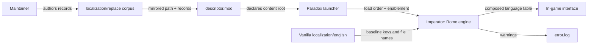
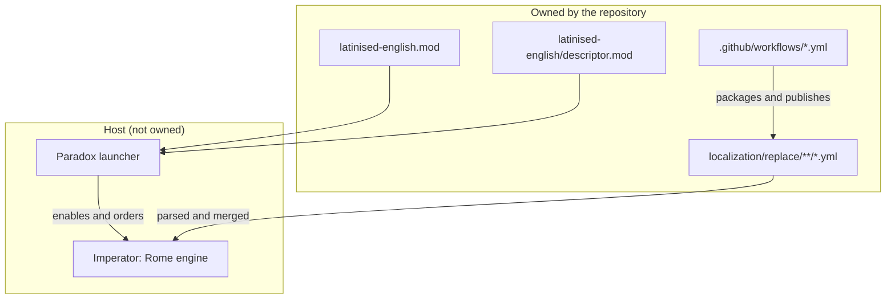

# Architecture

This document elaborates on the root [ARCHITECTURE.md](../ARCHITECTURE.md) without duplicating it. It records the verified decomposition, the direction of dependency between the parts, and the consequences that follow from the repository being a content-only host extension.

## System boundary

The system is a packaged content directory consumed by Imperator: Rome. Nothing the repository ships executes on its own; the engine is the only actor that initiates behaviour. Consequently, the architecture is the file layout plus the engine contract, and nothing more.



## Decomposition

The verified decomposition has three areas, none of which depends on another at runtime:

| Area | Paths | Owns |
|------|-------|------|
| Mod content | `latinised-english/` | The override corpus and the content descriptor |
| Launcher descriptor | `latinised-english.mod` | The local-mod registration the launcher lists before publication |
| Repository metadata | root Markdown, `LICENSE`, `.github/`, `description/` | Documentation, licence, artwork, and the Workshop page body |

The dependency direction is strictly inward: repository metadata describes content; content depends on the engine and descriptor contracts; the engine and launcher are the host. Nothing in the repository depends on the host at build time, because there is no build.

## Why there is no build or runtime

A conventional architecture document would describe a composition root, a dependency-injection graph, and a process topology. None exist here. The reasons are structural:

- The engine discovers files rather than entry points, so there is nothing to compose.
- The merge precedence is fixed by directory (`replace` is applied last), so there is no configuration to wire.
- The data is static, so there is no initialisation order to define.

The only ordering that matters is filesystem-level: the `replace` subtree is applied after every other localisation source. See [flows/localisation-override-resolution.md](./flows/localisation-override-resolution.md).

## Component relationships



The release workflows are the only owned component that acts without the host present. They package the descriptor and corpus into an archive and publish it; they do not alter the content semantics. See [components/packaging-and-distribution.md](./components/packaging-and-distribution.md).

## Runtime topology

There is no process owned by the repository. The only topology is the launcher-to-engine path:

```text
launcher start
  -> enumerate mod directory and parse descriptors
  -> read enabled playset and its order
  -> load vanilla localisation (localization/english)
  -> load each enabled mod's localisation tree in order
  -> apply localization/replace last so its records win
  -> compose the active language table
  -> resolve keys while rendering interface strings
```

## Consequences of the architecture

| Characteristic | Consequence |
|----------------|-------------|
| No runtime owned | The repository cannot observe, instrument, or repair behaviour at runtime |
| Filesystem precedence | Override correctness depends on placement, not on load order |
| Static data | Every change is a file edit; there is no migration or refactor step |
| Sense-dependent authoring | Substitutions are applied by judgement, so records carry no mechanical provenance |
| Checksum alteration | Enabling the mod changes the game checksum, disabling achievements |

## Related documents

See [design-decisions.md](./design-decisions.md) for the rationale behind these choices, [invariants.md](./invariants.md) for the contracts that must hold, and [dependencies.md](./dependencies.md) for the external responsibilities the architecture relies upon.
