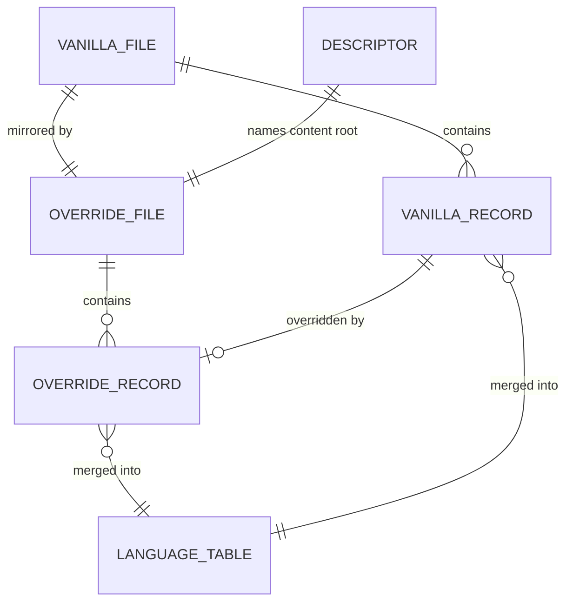
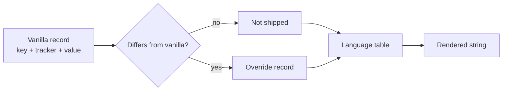

# Data model

The repository owns no store, cache, or persistent state. Its only data is the set of override records and the descriptors that describe the package. This document records the shape and lifecycle of each.

## Data entities

### Override record

| Property | Detail |
|----------|--------|
| Owner | Mod content |
| Representation | `key:tracker "value"` line in a UTF-8-BOM `.yml` file under `localization/replace/` |
| Lifecycle | Authored once, shipped statically, superseded by editing the file |
| Identity | The key name, which must match the vanilla key |
| Tracker | A number preserved from vanilla; observed range `0`–`7` |
| Value | The replacement string, fully quoted on one line |

### Localisation file

| Property | Detail |
|----------|--------|
| Owner | Mod content |
| Representation | A UTF-8-BOM text file named `<name>_latinised_l_english.yml` |
| Structure | One `l_english:` header, then indented records |
| Lifecycle | Static |
| Mirror | Maps one-to-one to a vanilla file at the same relative path |

### Mod descriptor

| Property | Detail |
|----------|--------|
| Owner | Launcher (read) and repository (authored) |
| Representation | `key="value"` block in `descriptor.mod` and `latinised-english.mod` |
| Lifecycle | Read at launcher start; rewritten by the launcher on publication |
| Fields | `name`, `version`, `supported_version`, `tags`, `path` |

### Vanilla baseline

| Property | Detail |
|----------|--------|
| Owner | Game installation |
| Representation | `localization/english` tree in the game directory |
| Lifecycle | Changes only with a game update |
| Role | Supplies the authoritative key set, file names, and the values the overrides replace |

### Composed language table

| Property | Detail |
|----------|--------|
| Owner | Engine |
| Representation | In-memory map from key to resolved value |
| Lifecycle | Rebuilt on every load; lost on exit |
| Role | The runtime data the interface resolves against |

## Relationships

## Record lifecycle

## Constraints

| Constraint | Rule |
|------------|------|
| Key identity | An override key must exist in the corresponding vanilla file |
| Minimality | An override value must differ from the vanilla value |
| Uniqueness | A key appears at most once within a file |
| Token preservation | Every engine token appears in the same order and form as in vanilla |
| Encoding | UTF-8 with BOM |
| Naming | `<name>_latinised_l_english.yml` mirroring the vanilla relative path |

## State and consistency

There is no mutable state, no migration, and no versioning of records. Consistency is a static property: either a shipped record satisfies the constraints or it is defective. The engine composes the table fresh on each load, so there is no cache invalidation problem. See [state-and-persistence.md](./state-and-persistence.md).
