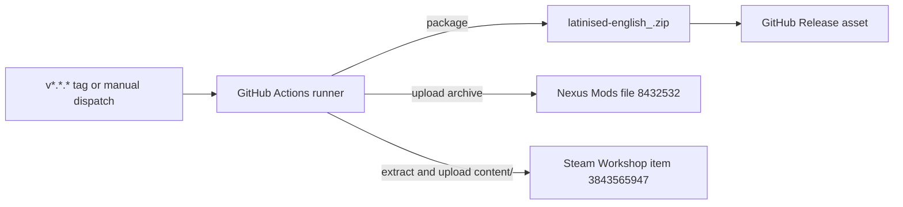

# Dependencies

The repository has no runtime dependencies in the conventional sense, because it has no runtime. Its dependencies are the external systems whose contracts it relies upon and the authoring input that determines its substitutions.

## External dependencies

| Dependency | Responsibility | Integration boundary | Architectural consequence |
|------------|----------------|----------------------|---------------------------|
| Imperator: Rome at version `2.0.*` | Parses the descriptor, loads the localisation corpus, composes the language table, and renders strings | The engine's localisation loader | Every invariant the repository can rely on is defined by the engine version, so a game update can change parsing and precedence |
| Vanilla English localisation corpus | Supplies the baseline key set and the file names the overrides mirror | The installed game directory | Override file names and key names are dictated by the installation, not by the repository |
| `english-language` vocabulary rules | Supplies the substitution set and the sense conditions applied when authoring records | Maintainer process, not runtime | Substitutions are applied by judgement at authoring time, so records carry no mechanical provenance |
| Paradox launcher | Reads the descriptors, lists the mod, resolves the content path, and owns enablement and load order | The `.mod` descriptor contract | The repository cannot control whether or how the mod loads |
| Steam Workshop | Hosts the primary distribution and the page body | `steam-workshop-release.yml` and `description/steam-workshop.bbcode` | Publication depends on Steam credentials supplied through GitHub secrets |
| Nexus Mods | Hosts a secondary distribution | `nexus-mods-release.yml` | Publication depends on a Nexus API key and a fixed file identifier |
| GitHub Releases | Hosts a versioned archive distribution | `github-release.yml` | Packaging depends on the tag naming convention |

## Host-version coupling

`supported_version="2.0.*"` in both descriptors binds the mod to the Imperator: Rome `2.0` line. The coupling is meaningful because:

- the engine's localisation parser and merge precedence are version-specific;
- the vanilla key set changes with game updates, so a key may disappear or acquire a different sense;
- a game update can therefore silently invalidate a shipped override.

There is no automated detection of drift. See [troubleshooting.md](./troubleshooting.md).

## Authoring dependency

The `english-language` vocabulary rules are an input to the maintainer's judgement, not a shipped artifact. The repository does not vendor, version, or reference them at runtime. Consequently:

- the substitution set cannot be regenerated mechanically from the repository;
- a reviewer must trust the maintainer's sense judgement or reproduce it from the vocabulary rules separately.

## Distribution dependency chain

Each channel is independent: a failure in one does not block the others, because they are separate workflow files with separate triggers.

## Dependency direction

Dependencies point inward from documentation to content to the host contracts, and never outward from content to anything the repository controls. See [architecture.md](./architecture.md) for the diagram and [invariants.md](./invariants.md) for the enforceable form of the descriptor and content rules.
