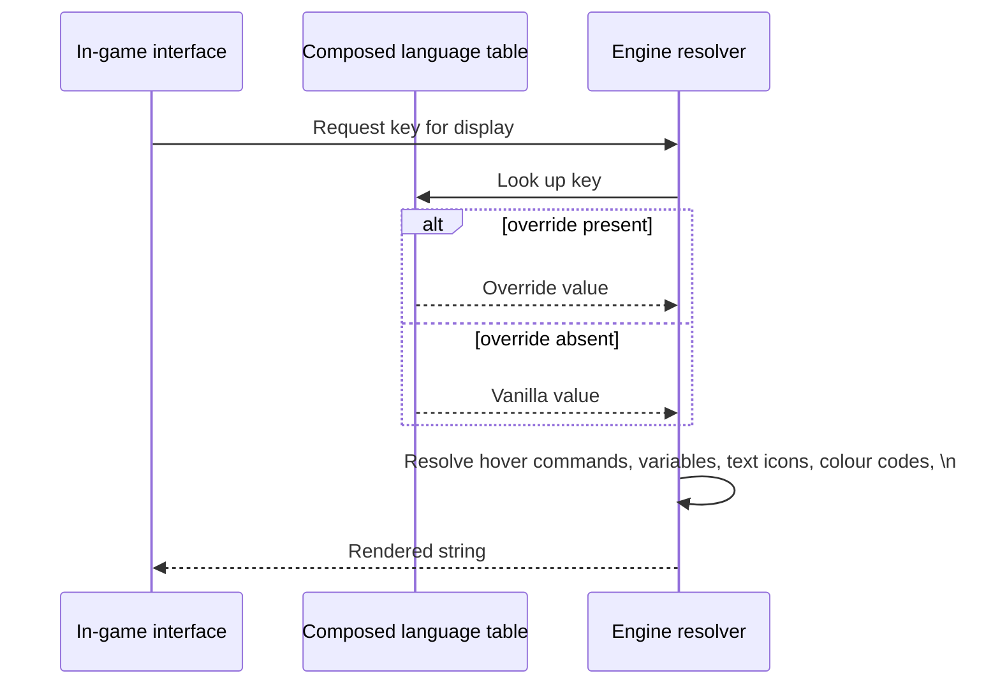

# Flow: localisation override resolution

This flow covers what happens when the interface requests a key and the composed language table contains both a vanilla value and an override.

## The precedence rule

The `replace` subtree is applied after every other localisation source. That single placement is the whole mechanism: a record shipped under `localization/replace` wins over a duplicate key in the vanilla tree or in another mod's default tree, without depending on file order or playset position.

## Sequence



## Decision logic

```text
request(key):
  if key in replace-overrides:
      value = replace-overrides[key]      # wins regardless of order
  else if key in vanilla:
      value = vanilla[key]
  else:
      value = unresolved                  # renders as the raw key or a placeholder
  substitute tokens in value
  return rendered value
```

## Why absence is indistinguishable from suppression

A record that is absent because its value matches vanilla is not a defect: the vanilla value remains in the table and is indistinguishable from an override that happened to be identical. This means:

- an override that was never authored and an override that was authored but not loaded both present as unchanged vanilla text;
- distinguishing them requires reading the shipped files rather than observing the game.

See [troubleshooting.md](../troubleshooting.md) for the diagnostic procedure.

## Token substitution

After the winning value is selected, the engine resolves the embedded constructs in place:

| Token | Resolution |
|-------|------------|
| `[SCOPE...]` / `[ROOT...]` / `[GetXxx...]` | Evaluated against the current scope |
| `$NAME$` | Substituted from the bound variable |
| `#T ...#!` and other colour spans | Applied as formatting |
| `@icon!` | Rendered as a text icon |
| `\n` | Rendered as a line break |

A malformed token renders literally or resolves to a placeholder instead of the intended content. This is why the token sequence is preserved exactly.

## Ownership

The engine owns the merge and the resolution. The repository's only levers are:

1. **where a record is placed** — under `replace`, for guaranteed precedence;
2. **whether its value is well formed** — a valid substitution with preserved tokens.

Nothing else about resolution is under repository control.

## Evidence

The precedence behaviour is stated in the root [ARCHITECTURE.md](../../ARCHITECTURE.md) and is consistent with the shipped layout: every override is under `latinised-english/localization/replace/`. The token classes are observed directly in the shipped values (see [components/mod-content.md](../components/mod-content.md)).
