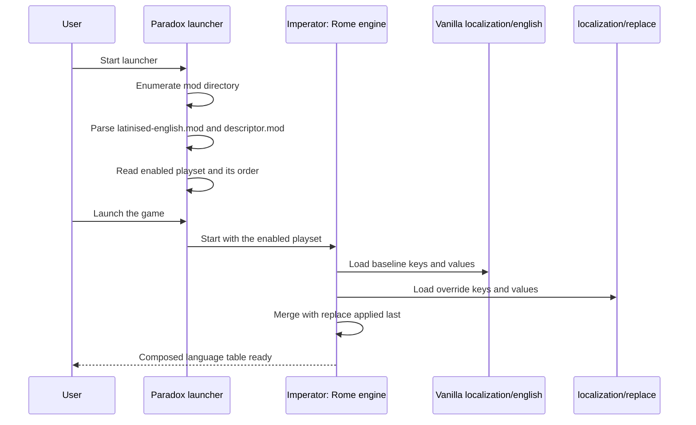

# Flow: mod discovery and load

This flow covers what happens from launcher start until the override corpus is part of the active language table.

## Participants

| Participant | Role |
|-------------|------|
| Paradox launcher | Enumerates mods, parses descriptors, owns the playset and load order |
| Imperator: Rome engine | Parses and merges localisation, composes the language table |
| Vanilla corpus | Supplies the baseline keys and values |
| Mod corpus | Supplies the overrides under `localization/replace` |

## Sequence

## Step detail

1. **Enumerate.** The launcher scans the Imperator mod directory. It finds `latinised-english.mod` at the repository root (or under `mod/` in a published install) and `latinised-english/descriptor.mod`.
2. **Parse.** The launcher reads `name`, `version`, `supported_version`, `tags`, and `path`. The `path` resolves to the content directory.
3. **Playset.** The launcher reads the enabled playset and its order. Enablement and position are owned by the user; the mod cannot set them.
4. **Load vanilla.** On game start, the engine loads `localization/english`, establishing the baseline key set.
5. **Load mods.** The engine loads each enabled mod's localisation tree in playset order.
6. **Apply replace.** The engine applies the `localization/replace` subtree after every other localisation source, so its records win over duplicate keys regardless of file order.
7. **Compose.** The engine builds the composed language table. Keys not overridden keep their vanilla values.

## Failure paths

| Failure | Where | Observable effect |
|---------|-------|-------------------|
| Descriptor unreadable or mislocated | Launcher | The mod is invisible in the mod list; no in-game error |
| `path` does not resolve | Launcher | The content is undiscoverable |
| File name does not match the localisation pattern | Engine | The file is ignored entirely, with no output |
| File missing its BOM | Engine | A load warning is written to `error.log` |
| A record's value contains an invalid token | Engine | The string renders incorrectly rather than raising an error |

## Evidence

The descriptor fields and paths are read from `latinised-english.mod` and `latinised-english/descriptor.mod` in the repository. The precedence of the `replace` subtree and the file-naming pattern are documented under the root [ARCHITECTURE.md](../../ARCHITECTURE.md) and are consistent with the shipped file names, all of which end in `_latinised_l_english.yml`.

## Related flows

- [localisation-override-resolution.md](./localisation-override-resolution.md) for what happens when a key is resolved.
- [override-authoring.md](./override-authoring.md) for how a maintainer adds a record.
