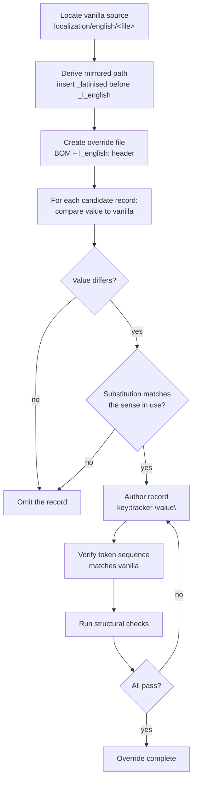

# Flow: override authoring

This flow covers how a maintainer adds or edits an override. It is the only workflow that changes shipped content.

## Prerequisites

- An installed copy of Imperator: Rome at version `2.0.*`, to read the vanilla localisation files the overrides mirror.
- The `english-language` vocabulary rules, to select the substitution for the sense in use.
- A text editor that writes UTF-8 with a BOM.

## Procedure



## Step detail

1. **Locate the vanilla source.** Read `<game>/localization/english/<file>_l_english.yml` and note its exact relative path and file name, including any quirks.
2. **Derive the mirrored path.** Insert `_latinised` before the `_l_english` suffix and place the file under `latinised-english/localization/replace/`. Preserve subdirectories (`deities/`, `missions/`) and any name irregularity exactly.
3. **Create the file.** Write a UTF-8 BOM followed by the header line `l_english:`.
4. **Compare each candidate record.** For each vanilla key, compare the value against the candidate substitution. Ship only records that differ.
5. **Apply the sense check.** Use the vocabulary record that covers the sense actually in use in the string. If a substitution could change the meaning or produce an ungrammatical result, omit the record.
6. **Author the record.** Write `KEY:tracker "value"` with the vanilla key and tracker preserved and the value fully quoted on one line.
7. **Preserve tokens.** Confirm every hover command, variable, text icon, colour code, and `\n` escape appears in the same order and form as in vanilla.
8. **Verify.** Run the structural check in [testing.md](../testing.md).

## Worked example

Vanilla (`alerts_l_english.yml`):

```text
 ALERT_AT_WAR_WITH:0 "#T War#!\nWe are currently at war with $DATA$."
```

Override (`alerts_latinised_l_english.yml`):

```text
 ALERT_AT_WAR_WITH:0 "#T Armed Conflict#!\nWe are currently at war with $DATA$."
```

The key and tracker are unchanged. The heading word changes. The colour span `#T ...#!`, the `\n` escape, and the `$DATA$` variable are preserved.

## Rejection cases

| Case | Reason |
|------|--------|
| The word is a proper noun or place-name component | Proper nouns are never translated |
| The vocabulary record targets a different sense | The substitution would change the meaning |
| The candidate substitution would drop or reorder a token | The consuming string would break |
| The value would be identical to vanilla | The record carries no information |
| The vanilla file holds no records | Nothing can be shipped from it |

## Completion criteria

The override is complete when every shipped record satisfies [invariants.md](../invariants.md) C5–C9 and the file satisfies C1–C4.
