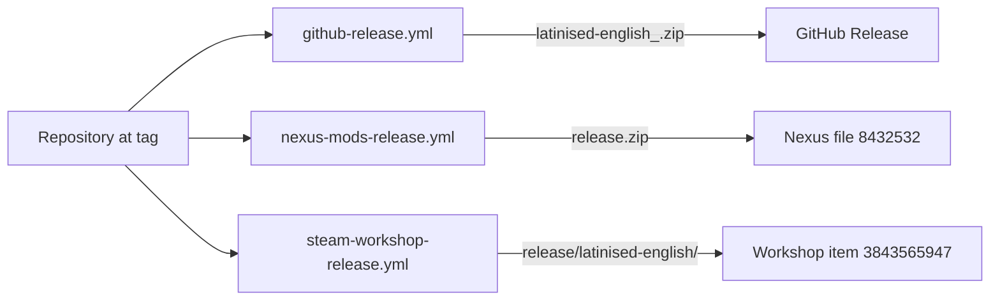

# Integrations

The repository integrates with the game engine, the launcher, and three distribution channels. It integrates with no runtime service, API, or data provider.

## Integration inventory

| Integration | Direction | Contract | Owner | Failure semantics |
|-------------|-----------|----------|-------|-------------------|
| Imperator: Rome engine | Inbound | Localisation file naming, `l_english:` header, UTF-8-BOM encoding, `key:tracker "value"` records, `localization/replace` precedence | Engine | A non-conforming file name is ignored entirely; a missing BOM warns; a malformed record is discarded |
| Paradox launcher | Inbound | `name`, `version`, `supported_version`, `tags`, `path` keys in a `.mod` file | Launcher | An unreadable or mislocated descriptor makes the mod invisible; the mod is skipped without an in-game error |
| Vanilla localisation corpus | Inbound | File names and key set | Game installation | A key that exists in the mod but not in vanilla overrides nothing |
| Steam Workshop | Outbound | Appid, item identifier, upload path, changenote | `steam-workshop-release.yml` | A failed upload leaves the item at its previous revision |
| Nexus Mods | Outbound | API key, file identifier, archive | `nexus-mods-release.yml` | A failed upload leaves the file at its previous revision |
| GitHub Releases | Outbound | Tag, archive name, release asset | `github-release.yml` | A failed upload leaves the release without an asset |

## Engine integration detail

The engine is the only integration that determines whether the product works. Its contract has four parts:

1. **Discovery.** Every `.yml` file under the content directory is read.
2. **Naming.** A file must match the `_l_english.yml` pattern to be recognised.
3. **Encoding and header.** A file must be UTF-8 with a BOM and begin with `l_english:`.
4. **Precedence.** The `replace` subtree is applied after every other source.

## Distribution chain

Each channel is a separate workflow file with its own trigger and secrets. No channel depends on another completing first.

## Integration boundaries that are deliberately absent

| Absent integration | Reason |
|--------------------|--------|
| Runtime API or web service | The mod has no runtime component |
| Telemetry or analytics | The mod collects and transmits no data |
| Authentication or authorisation | The mod authenticates against nothing |
| Database or state store | The mod owns no state |
| Compiler or package manager | There is nothing to build |

## Evidence

All contracts above are derived from the shipped files (`latinised-english.mod`, `latinised-english/descriptor.mod`, the corpus) and the workflow definitions under `.github/workflows/`.
