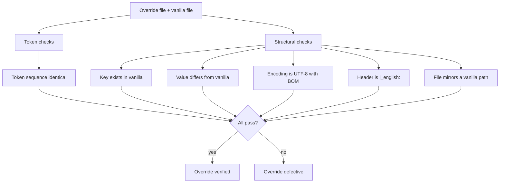

# Testing

Verification is manual and comparative, because the repository has no test project and the engine exposes no assertion surface. The verifiable boundary is the pair of a shipped override and its vanilla source.

## Verification model



## Structural and token check

The core check is that each override file parses under the localisation rules, that every key it contains exists in the corresponding vanilla file, that no value is identical to its vanilla counterpart, and that every engine token sequence is preserved. A shell one-liner over a single pair performs the structural part:

```bash
python3 - <<'PY'
import re
VAN = '/path/to/game/localization/english/alerts_l_english.yml'
GEN = 'latinised-english/localization/replace/alerts_latinised_l_english.yml'
TOK = re.compile(r"\[[^\]]*\]|\$[^$]*\$|@[A-Za-z0-9_]+!|#[A-Za-z]+ ?|#!|\\n")
def load(path):
    out = {}
    for line in open(path, encoding='utf-8-sig').read().splitlines():
        m = re.match(r'^\s*([A-Za-z0-9_.\-]+):(\d*)\s*"(.*)"\s*$', line)
        if m:
            out[m.group(1)] = m.group(3)
    return out
van, gen = load(VAN), load(GEN)
assert not [k for k in gen if k not in van], 'unknown key'
assert not [k for k in gen if van[k] == gen[k]], 'redundant record'
assert not [k for k in gen if TOK.findall(van[k]) != TOK.findall(gen[k])], 'token drift'
print('ok', len(gen), 'of', len(van))
PY
```

## Corpus-wide structural check

The following check was used to produce the metrics in this documentation. It verifies encoding, header, record shape, and file count across the whole shipped corpus without requiring an installed game:

```bash
python3 - <<'PY'
import re, glob
rec = re.compile(r'^\s*([A-Za-z0-9_.\-]+):(\d*)\s*"(.*)"\s*$')
tot = files = 0
empty, nobom, nohdr, unclosed = [], [], [], 0
for p in glob.glob('latinised-english/localization/replace/**/*.yml', recursive=True):
    files += 1
    b = open(p, 'rb').read()
    if not b.startswith(b'\xef\xbb\xbf'):
        nobom.append(p)
    lines = b.decode('utf-8-sig').splitlines()
    if not lines or not lines[0].startswith('l_english:'):
        nohdr.append(p)
    n = sum(1 for l in lines if rec.match(l))
    tot += n
    if n == 0:
        empty.append(p)
    for l in lines:
        if re.match(r'^\s*[A-Za-z0-9_.\-]+:\d*\s*"', l) and not l.endswith('"'):
            unclosed += 1
print('files', files, 'records', tot)
print('no BOM', len(nobom), 'no header', len(nohdr), 'empty', len(empty), 'unclosed', unclosed)
PY
```

## Manual verification steps

1. Enable the mod in the launcher and confirm the mod list shows the declared name and version.
2. Launch the game and confirm the affected strings display the overridden wording.
3. Read `<user data>/Imperator/logs/error.log` and confirm no encoding or parse warning names a shipped file.

## Coverage of the verification

| Check | Automated | Requires installed game |
|-------|-----------|-------------------------|
| BOM per file | Yes | No |
| Header per file | Yes | No |
| Record shape | Yes | No |
| No empty files | Yes | No |
| Key exists in vanilla | Yes (with vanilla files) | Yes |
| Value differs from vanilla | Yes (with vanilla files) | Yes |
| Token sequence preserved | Yes (with vanilla files) | Yes |
| Rendered string correct | No | Yes |

## Material coverage gaps

- There is no automated test suite, so every check is manual and no regression is caught without running it.
- Coverage is partial by design, so absence of an override is indistinguishable from a suppression without reading the files.
- Engine-side behaviour can only be verified against an installed game, so the repository cannot be validated in isolation.
- A game update can invalidate a record silently; no drift detection exists.

## Test values

No test fixtures exist, because there is no test suite. The structural checks operate on the shipped corpus and the vanilla baseline directly.
