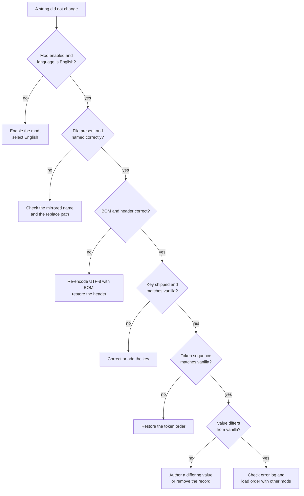

# Troubleshooting

Recurring problems and their resolutions. The repository cannot catch a failure at runtime, so diagnosis proceeds by eliminating the candidate causes in order.

## Diagnostic procedure

## Problems

| Symptom | Probable cause | Resolution |
|---------|----------------|------------|
| The mod does not appear in the launcher | Descriptor missing, unreadable, or mislocated | Confirm `latinised-english.mod` and `latinised-english/descriptor.mod` exist and parse |
| The mod appears but has no effect | The content path does not resolve | Confirm `path="mod/latinised-english"` matches the installed directory name |
| A string is unchanged | The key is not shipped | Confirm the record exists in the mirrored override file |
| A string is unchanged | The value equals vanilla | Author a differing value or remove the redundant record |
| A string is unchanged | Another localisation mod wins | Place this mod after the competing mod; both using `replace` resolves by load order |
| A string renders incorrectly (broken tooltip) | An engine token was altered, dropped, or reordered | Restore the token sequence to match vanilla |
| A tooltip shows a raw token or placeholder | A malformed token in the value | Compare against vanilla and repair the token |
| The file loaded but nothing changed | A key not present in vanilla | Correct the key to match the vanilla key |
| A load warning names a shipped file | Missing BOM or invalid encoding | Re-encode the file as UTF-8 with a BOM |
| The game warns and the file is ignored | File name does not match `_l_english.yml` | Rename to mirror the vanilla file with the `_latinised` marker |
| Duplicate-key behaviour (only one value applies) | The key appears more than once in a file | Remove the duplicate record |
| Old content persists after updating | Leftover files from the previous version | Delete the `latinised-english` directory and `latinised-english.mod`, then reinstall |
| Achievements are disabled | The mod changes the checksum | Inherent to localisation overrides; disable the mod for achievement runs |
| An ironman save will not load | A checksum-changing mod on an ironman campaign | Do not enable the mod on ironman campaigns |

## Interpreting the log

Read `<user data>/Imperator/logs/error.log` after launching the game:

| Log entry | Meaning |
|-----------|---------|
| An encoding warning naming a file | That file lacks a BOM or has invalid encoding |
| A parse warning naming a file | A record in that file is malformed |
| No warning | The corpus loaded cleanly; a missing substitution is authoring-side, not load-side |

## Distinguishing absence from suppression

The hardest diagnostic case is a string that is unchanged by design versus one whose override failed to load. Both look identical in game. Resolve it by reading the shipped files:

1. Locate the vanilla file and its mirrored override.
2. Search the override for the key.
3. If the key is absent, the string was deliberately left unchanged.
4. If the key is present, the override exists and the problem is elsewhere in the diagnostic tree.
